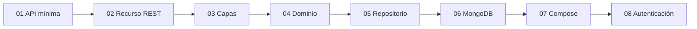

# Evolución de la API FastAPI

Repositorio de Paradigmas de Programación V (FIE). Muestra cómo crece una
misma aplicación de tienda, de una ruta suelta a un ambiente con MongoDB y
Keycloak.

Cada capa es una rama ejecutable. `main` no contiene la aplicación: es el mapa
para no entrar por el final. Clonar y quedarse en `main` no levanta la API.

```bash
git clone https://github.com/paradigmas-v-fie/fastapi-evolucion.git
cd fastapi-evolucion
git switch 01-api-minima
```

## Recorrido

| Rama | Qué aparece | Cómo se ejecuta |
| --- | --- | --- |
| `01-api-minima` | Una ruta y OpenAPI | `uv run fastapi dev main.py` |
| `02-recurso-rest` | `/productos` en memoria, en un solo archivo | igual |
| `03-capas` | router, service y schemas | igual |
| `04-dominio` | `Producto` e IVA; el DTO queda en el borde | igual |
| `05-repositorio` | el service deja de guardar la lista | igual |
| `06-mongodb` | MongoDB; Compose levanta solo la base | `docker compose up -d` y después `uv run fastapi dev main.py` |
| `07-compose` | la API también va en un contenedor | `docker compose up --build` |
| `08-autenticacion` | Keycloak; las escrituras exigen rol `admin` | `docker compose up --build` |

El contrato de `/productos` aparece en `02-recurso-rest` y se mantiene. En
`04-dominio` la respuesta suma `precio_final`. En `08-autenticacion` crear,
reemplazar y borrar pasan a exigir token. El resto de los cambios son de
estructura, no de verbos.



## Ver qué cambió entre dos capas

Cada rama contiene el proyecto completo de esa etapa, no un parche suelto.
El diff entre dos ramas es el contenido de la clase:

```bash
git diff 04-dominio..05-repositorio
git log --oneline 01-api-minima..08-autenticacion
```

Dentro de cada rama, el `README.md` dice cómo ejecutarla y qué mirar.

## Requisitos

- [uv](https://docs.astral.sh/uv/getting-started/installation/)
- Python 3.13. Si no está instalado: `uv python install 3.13`
- Desde `06-mongodb`, Docker con Compose

Hasta `05-repositorio` no hace falta Docker. `bash verificar.sh` corre los
tests de la capa actual sin levantar servicios.

## Correspondencia con las clases

| Clases de H2 | Ramas |
| --- | --- |
| Primera API y recurso REST | `01-api-minima`, `02-recurso-rest` |
| Capas y dominio | `03-capas`, `04-dominio` |
| Repository y MongoDB | `05-repositorio`, `06-mongodb` |
| Ambiente con Compose | `07-compose` |
| Autenticación y autorización | `08-autenticacion` |

`05-repositorio` no tiene una clase propia en el cronograma anterior: está para
ver el contrato del repositorio antes de mezclarlo con MongoDB.

## Qué no está acá

Las diapositivas, los ejercicios y los checkpoints viven en el material de la
cursada. Este repositorio es solo la aplicación y su evolución.

Las contraseñas de Mongo y Keycloak son de un entorno local de clase. No sirven
fuera de la máquina de quien levanta Compose.
